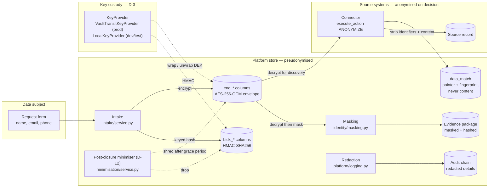
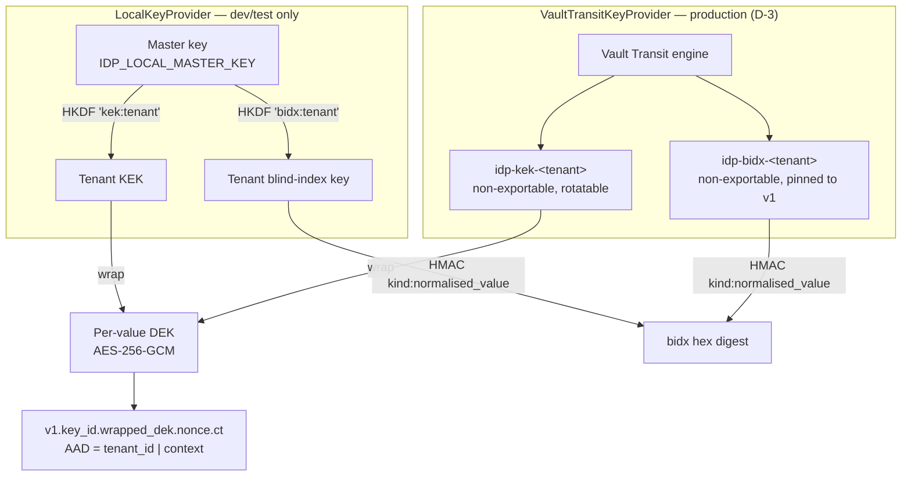
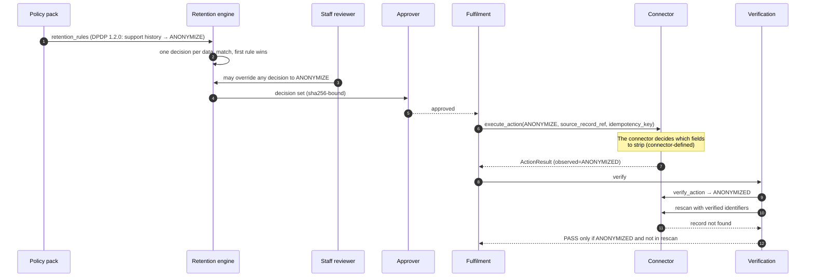
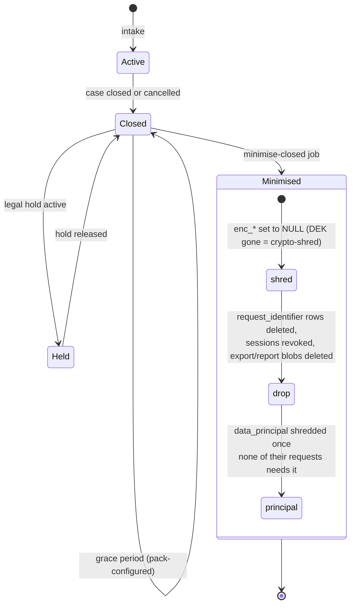

# Anonymisation and Pseudonymisation

The platform handles personal data in two separate places, and each gets different protection:

- **Source systems** (CRM, billing and so on) hold the data subject's records. When a retention decision says `ANONYMIZE`, the platform tells the source system's connector to anonymise the record and then checks the result. The platform never anonymises source data itself.
- **The platform's own store** keeps the case: the requester's name, identifiers, pointers to matched records, and evidence. This data is pseudonymised. Values are encrypted, and lookups use keyed hashes (blind indexes). Staff and evidence only ever see masked values. After a case closes and its grace period passes, this data is shredded (D-12).

Key custody (D-3) is HashiCorp Vault Transit in production and a derived local key in dev/test.

## 1. Overview

## 2. Pseudonymisation: the key hierarchy

Every `enc_*` value has its own data key (DEK). The DEK is wrapped by the tenant's key (KEK). The tenant id and the column context are bound into the encryption as associated data, so a ciphertext fails to decrypt if it is moved to another tenant or column. The blind-index key is a separate per-tenant key, so a stolen table of hashes can't be checked against guessed emails or phone numbers without that key.

With Vault Transit, neither key ever leaves Vault. The platform sends the DEK to Vault to be wrapped and unwrapped, and sends the identifier to Vault to be HMAC'd. The `key_id` in each ciphertext (`local-1` or `vault`) records which provider wrapped it.

| Pseudonymised field | Encrypted column | Blind index | Code |
|---|---|---|---|
| Data subject identifiers | `data_principal.enc_identifiers` | `bidx_email`, `bidx_phone` | [intake/service.py](../../apps/api/src/idprivacy/domain/intake/service.py) |
| Name, submitted identifiers | `privacy_request.enc_full_name`, `enc_submitted_identifiers` | — | intake/service.py |
| Request details | `request_right.enc_details` | — | intake/service.py |
| Resolved identifiers | `request_identifier.enc_value` | `request_identifier.bidx` | [identity/resolution.py](../../apps/api/src/idprivacy/domain/identity/resolution.py) |
| OTP | — | `challenge_hash` (keyed HMAC) | [identity/verification.py](../../apps/api/src/idprivacy/domain/identity/verification.py) |
| Staff email | `app_user.enc_email` | — | seed / OIDC |
| Disclosure export, access report | encrypted blob | — | [disclosure/](../../apps/api/src/idprivacy/domain/disclosure/) |
| Session token | — | `token_hash` (SHA-256) | [dp_session.py](../../apps/api/src/idprivacy/platform/auth/dp_session.py) |

Operations:

- Set `IDP_KEY_PROVIDER=vault`, `IDP_VAULT_ADDR` (https outside local/test), `IDP_VAULT_TOKEN` and optionally `IDP_VAULT_TRANSIT_MOUNT`.
- Run `make vault-provision` after adding a tenant. It is safe to repeat.
- The KEK can be rotated in Vault at any time. **Never rotate `idp-bidx-*`:** every stored blind index would stop matching.
- If Vault is unreachable, calls raise `KeyServiceError`, not `DecryptionError`, so an outage is never mistaken for tampered data.

Code: [platform/crypto.py](../../apps/api/src/idprivacy/platform/crypto.py), [runtime.py](../../apps/api/src/idprivacy/runtime.py) (`build_keys`), [scripts/vault_provision.py](../../apps/api/src/idprivacy/scripts/vault_provision.py).

## 3. Anonymisation: from decision to verification

Code: [fulfilment/service.py](../../apps/api/src/idprivacy/domain/fulfilment/service.py) (dispatch), [verification/service.py](../../apps/api/src/idprivacy/domain/verification/service.py) (`judge`), [mock_connectors/app.py](../../packages/mock-connectors/src/mock_connectors/app.py) (reference behaviour), [dpdp/1.2.0/pack.yaml](../../packages/policy-packs/dpdp/1.2.0/pack.yaml) (`support-history-anonymise`).

The platform doesn't define which fields a connector must remove. The rescan is the only check: after anonymisation, the record must no longer match the requester's identifiers.

## 4. Post-closure minimisation (D-12)

After a case closes, the platform keeps only what the evidence needs. Once the pinned pack's `post_closure_retention_days` has passed (default 30), `make minimise-closed` shreds the case's personal data. A legal hold blocks it if it covers the case, the data principal, or a connector or record type the case touched.

What survives minimisation: case ids, dates, the rights exercised, masked identifiers inside the evidence package, record pointers (`source_record_ref`, `content_fingerprint`), decisions, approvals, verification results and the audit hash chain. None of these can be read back to a person without the source system.

After minimisation, a returning sign-in or OTP resend for that case acts as if no case matches, and the staff disclosure view opens without the deleted export.

Code: [minimisation/service.py](../../apps/api/src/idprivacy/domain/minimisation/service.py), [scripts/minimise_closed.py](../../apps/api/src/idprivacy/scripts/minimise_closed.py), migration [0012_minimisation.py](../../apps/api/migrations/versions/0012_minimisation.py).
