# Entity-Relationship Diagram

Conventions:
- Every table except `tenant` and the global `policy_pack` catalogue carries `tenant_id` (FK → tenant). Composite FKs `(tenant_id, x_id)` are used so a child row can't reference a parent in another tenant.
- PK is `id UUID` (v4 in M0; move to time-ordered v7 once the runtime provides it natively). `created_at` / `updated_at` are `timestamptz`.
- `enc_*` columns hold application-layer ciphertext (envelope-encrypted). `bidx_*` columns hold HMAC blind indexes for equality lookup.
- `audit_event` is INSERT-only (ADR-0004).

```mermaid
erDiagram
  TENANT ||--o{ USER : has
  TENANT ||--o{ ROLE : defines
  USER }o--o{ ROLE : "user_role"
  TENANT ||--o{ DATA_PRINCIPAL : has
  TENANT ||--o{ SLA_POLICY : configures
  POLICY_PACK ||--o{ SLA_POLICY : "default for"
  DATA_PRINCIPAL ||--o{ PRIVACY_REQUEST : submits
  PRIVACY_REQUEST ||--|{ REQUEST_RIGHT : invokes
  PRIVACY_REQUEST ||--o{ IDENTITY_VERIFICATION : "verified by"
  PRIVACY_REQUEST ||--o{ DP_SESSION : "tracked via"
  PRIVACY_REQUEST ||--o{ REQUEST_IDENTIFIER : "resolved to"
  TENANT ||--o{ TENANT_POLICY_PACK : enables
  TENANT_POLICY_PACK }o--|| POLICY_PACK : "pins version"
  PRIVACY_REQUEST ||--o| JURISDICTION_DECISION : "governed by"
  JURISDICTION_DECISION }o--|| POLICY_PACK : "pins version"
  PRIVACY_REQUEST ||--o{ DISCOVERY_JOB : runs
  TENANT ||--o{ CONNECTOR_CONFIG : configures
  CONNECTOR_CONFIG ||--o{ DISCOVERY_JOB : "searched by"
  DISCOVERY_JOB ||--o{ DATA_MATCH : finds
  DATA_MATCH ||--o{ RETENTION_DECISION : "decided by (latest effective)"
  LEGAL_HOLD }o--o{ DATA_MATCH : "may constrain"
  TENANT ||--o{ LEGAL_HOLD : has
  PRIVACY_REQUEST ||--o{ APPROVAL_SUBMISSION : "submitted as"
  APPROVAL_SUBMISSION ||--o| APPROVAL : "decided by (one per submission)"
  PRIVACY_REQUEST ||--o{ APPROVAL : requires
  APPROVAL }o--|| USER : "approved by"
  PRIVACY_REQUEST ||--o{ FULFILMENT_TASK : executes
  FULFILMENT_TASK }o--|| DATA_MATCH : "acts on"
  FULFILMENT_TASK }o--|| RETENTION_DECISION : "authorised decision"
  FULFILMENT_TASK }o--o| APPROVAL : "authorised by"
  FULFILMENT_TASK ||--o{ CONNECTOR_EXECUTION : attempts
  FULFILMENT_TASK ||--o{ VERIFICATION_RESULT : "verified by"
  PRIVACY_REQUEST ||--o{ COMMUNICATION : sends
  PRIVACY_REQUEST ||--o{ EVIDENCE_ARTIFACT : produces
  TENANT ||--o{ AUDIT_EVENT : records

  TENANT {
    uuid id PK
    string slug UK
    string name
    string status
    string data_region "D-6"
  }
  USER {
    uuid id PK
    uuid tenant_id FK
    string idp_subject "UK(idp_issuer, idp_subject): one identity, one tenant (D-1)"
    string idp_issuer
    string enc_email
    string display_name
    string status
  }
  ROLE {
    uuid id PK
    uuid tenant_id FK
    string code "TENANT_ADMIN|PRIVACY_ANALYST|APPROVER|AUDITOR"
  }
  DATA_PRINCIPAL {
    uuid id PK
    uuid tenant_id FK
    string enc_identifiers "canonical identifier set (JSON, encrypted)"
    string bidx_email
    string bidx_phone
  }
  PRIVACY_REQUEST {
    uuid id PK
    uuid tenant_id FK
    string display_id "UK(tenant_id, display_id); non-sequential"
    uuid data_principal_id FK
    string status
    string channel "WEB"
    int version "optimistic lock"
    timestamptz submitted_at
    timestamptz due_at
    timestamptz closed_at
  }
  REQUEST_RIGHT {
    uuid id PK
    uuid tenant_id FK
    uuid request_id FK
    string right_code "ERASURE|ACCESS|CORRECTION|CONSENT_WITHDRAWAL|GRIEVANCE|NOMINATION"
    string enc_details
  }
  REQUEST_IDENTIFIER {
    uuid id PK
    uuid tenant_id FK
    uuid request_id FK
    string type "EMAIL|PHONE|CUSTOMER_ID"
    string bidx "HMAC blind index"
    string enc_value
    string assurance "VERIFIED|CLAIMED"
    string source "OTP|FORM"
  }
  TENANT_POLICY_PACK {
    uuid tenant_id PK
    string pack_code PK
    string pack_version
    int priority
    bool enabled
  }
  DP_SESSION {
    uuid id PK
    uuid tenant_id FK
    uuid request_id FK
    string token_hash "UK; sha256 of opaque token"
    timestamptz idle_expires_at
    timestamptz absolute_expires_at
    timestamptz revoked_at
  }
  IDENTITY_VERIFICATION {
    uuid id PK
    uuid tenant_id FK
    uuid request_id FK
    string method "OTP_EMAIL|OTP_SMS"
    string provider "mock"
    string challenge_hash "keyed HMAC of OTP; never plaintext"
    int attempts
    int max_attempts
    int resend_count
    timestamptz last_sent_at
    timestamptz expires_at
    timestamptz verified_at
    string status "PENDING|VERIFIED|FAILED|EXPIRED"
  }
  JURISDICTION_DECISION {
    uuid id PK
    uuid tenant_id FK
    uuid request_id FK
    string outcome "APPLICABLE|NO_APPLICABLE_PACK"
    string regulation "pack code, e.g. DPDP"
    uuid policy_pack_id FK "null if no pack applies"
    string policy_pack_version "1.0.0"
    json inputs "residency claim, tenant config"
    string rationale
  }
  POLICY_PACK {
    uuid id PK
    string code "DPDP"
    string version "semver; UK(code,version)"
    string content_sha256
    json content "immutable once published"
    string status "DRAFT|PUBLISHED|RETIRED"
  }
  SLA_POLICY {
    uuid id PK
    uuid tenant_id FK
    uuid policy_pack_id FK
    string right_code
    int response_days "value = decision D-9"
    string clock_start "VERIFIED|SUBMITTED"
  }
  CONNECTOR_CONFIG {
    uuid id PK
    uuid tenant_id FK
    string connector_id "UK per tenant"
    string kind "http_v1"
    string base_url
    string credential_ref "e.g. env:NAME (D-5); never the secret"
    bool enabled
  }
  DISCOVERY_JOB {
    uuid id PK
    uuid tenant_id FK
    uuid request_id FK
    uuid connector_config_id FK
    string purpose "INITIAL|VERIFICATION_RESCAN"
    string status
    timestamptz started_at
    timestamptz finished_at
  }
  DATA_MATCH {
    uuid id PK
    uuid tenant_id FK
    uuid discovery_job_id FK
    string connector_id
    string source_record_ref "opaque pointer, no PII"
    string record_type "e.g. crm.contact, docs.file"
    json data_categories "e.g. [contact, financial]"
    string content_fingerprint "sha256 of normalised record"
    json attributes "non-PII metadata used by retention rules"
  }
  RETENTION_DECISION {
    uuid id PK
    uuid tenant_id FK
    uuid request_id FK
    uuid data_match_id FK
    uuid legal_hold_id FK "set when a hold forced RETAIN"
    string decision "DELETE|RETAIN|RESTRICT|ANONYMIZE|MANUAL_REVIEW"
    string source "ENGINE|ANALYST_OVERRIDE"
    string rule_id "policy-pack rule reference"
    string exception_code "required if RETAIN/override"
    string exception_reason
    uuid decided_by FK "null if ENGINE"
    uuid supersedes_id FK "UK; append-only chain, one root per match"
  }
  LEGAL_HOLD {
    uuid id PK
    uuid tenant_id FK
    string scope "CASE|DATA_PRINCIPAL|CONNECTOR|RECORD_TYPE"
    string scope_ref
    string matter_ref
    string reason "10-2000 chars"
    uuid created_by FK
    timestamptz released_at
    uuid released_by FK
  }
  APPROVAL_SUBMISSION {
    uuid id PK
    uuid tenant_id FK
    uuid request_id FK
    uuid submitted_by FK "maker"
    int case_version
    string decision_set_sha256
  }
  APPROVAL {
    uuid id PK
    uuid tenant_id FK
    uuid request_id FK
    uuid submission_id FK "UK"
    string idempotency_key "UK per tenant; response replayed verbatim"
    int case_version "binds approval to reviewed state"
    string decision_set_sha256 "hash of decisions approved"
    uuid submitted_by FK "maker"
    uuid approved_by FK "checker; CHECK != submitted_by"
    string outcome "APPROVED|REJECTED"
    string comment
  }
  FULFILMENT_TASK {
    uuid id PK
    uuid tenant_id FK
    uuid request_id FK
    uuid data_match_id FK "UK(match, approval)"
    uuid retention_decision_id FK
    uuid approval_id FK
    uuid connector_config_id FK
    string action "DELETE|ANONYMIZE|RESTRICT|NOOP_RETAIN"
    string idempotency_key "UK"
    string status "PENDING|DISPATCHED|SUCCEEDED|FAILED_RETRYABLE|FAILED_FINAL|SKIPPED|CANCELLED"
    int attempt_count
  }
  CONNECTOR_EXECUTION {
    uuid id PK
    uuid tenant_id FK
    uuid fulfilment_task_id FK
    string idempotency_key
    int attempt_no
    string operation "execute_action|verify_action|get_evidence"
    string outcome
    string connector_receipt_id
    string evidence_sha256
    timestamptz started_at
    timestamptz finished_at
  }
  VERIFICATION_RESULT {
    uuid id PK
    uuid tenant_id FK
    uuid fulfilment_task_id FK
    int round "UK(task, round)"
    string expected "ABSENT|ANONYMIZED|RESTRICTED|PRESENT"
    string observed_verify "connector's answer"
    string observed_rescan "independent rescan"
    string outcome "PASS|FAIL"
  }
  COMMUNICATION {
    uuid id PK
    uuid tenant_id FK
    uuid request_id FK
    string template_code
    string channel "mock"
    string status
    string body_sha256
  }
  EVIDENCE_ARTIFACT {
    uuid id PK
    uuid tenant_id FK
    uuid request_id FK
    string kind "PACKAGE|UPLOAD"
    string manifest_sha256 "PACKAGE only; also in audit chain"
    string object_key "opaque, tenant-prefixed"
    string sha256
    int size_bytes
    string media_type
    timestamptz retain_until "D-4"
  }
  AUDIT_EVENT {
    bigint seq PK "per-tenant monotonic"
    uuid tenant_id FK
    timestamptz occurred_at
    string actor_type "USER|DATA_PRINCIPAL|SYSTEM|CONNECTOR"
    string actor_ref
    string action
    string object_type
    uuid object_id
    json details "redacted, no PII"
    string prev_hash
    string hash "sha256(prev_hash || canonical(event))"
  }
```

## Key integrity constraints

- `UNIQUE (tenant_id, display_id)` on `privacy_request`.
- `UNIQUE (idempotency_key)` on `fulfilment_task`. `UNIQUE (idempotency_key, attempt_no, operation)` on `connector_execution`.
- `CHECK (approved_by <> submitted_by)` on `approval`, plus a service-layer check that the approver didn't author any `ANALYST_OVERRIDE` in the approved decision set.
- `CHECK (decision <> 'RETAIN' OR exception_code IS NOT NULL)`, and the same check for any `ANALYST_OVERRIDE`.
- `retention_decision`, `approval`, `connector_execution`, `verification_result` and `audit_event` are append-only (no UPDATE grant). Corrections create a superseding row.
- A DB trigger on `privacy_request` rejects `status = 'CLOSED'` while any `fulfilment_task` for the request is non-terminal. The service layer enforces the same rule; the trigger is defence in depth.
