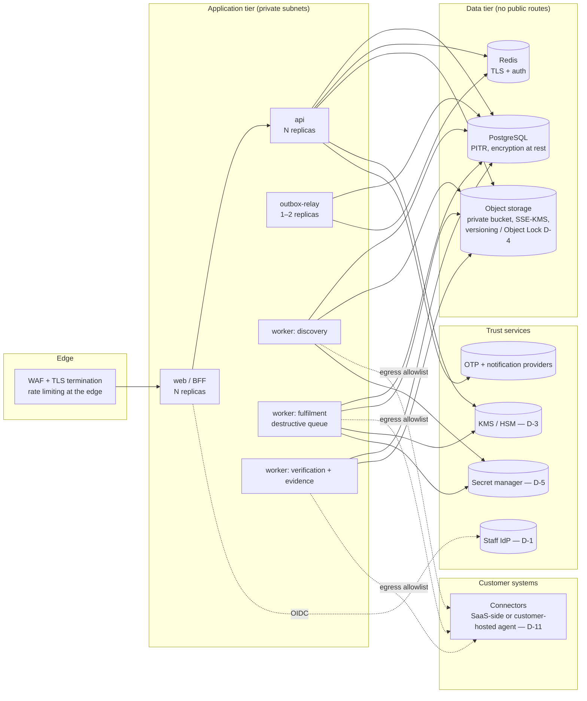

# Production Deployment Architecture

**Status:** design only. v1 ships as Docker Compose for local development. Nothing here is built. Choices marked with a decision ID are still open (see `open-decisions.md`), and this document describes the shape each one must fit into rather than presuming the answer.

## 1. Topology

## 2. Component requirements

| Component | Requirement | Source |
|---|---|---|
| web (BFF) | The only internet-facing app. Stateless; sessions in Redis. HSTS and nonce-CSP are already implemented. Authenticates to the API with **mTLS or workload identity**, replacing the dev shared secret. | ADR-0003, D-18 |
| api | Private. Validates staff JWTs against the production IdP's JWKS. Runs as the `idp_app` role (no BYPASSRLS, not the owner). Boot fails if any dev stand-in is configured (already enforced by `Settings`). | ADR-0002/3 |
| outbox-relay | Runs as the `idp_relay` role, which can see only the outbox. At least one replica; `SKIP LOCKED` makes several safe. | ADR-0005 |
| workers | Separate queues and deployments per stage. The fulfilment (destructive) queue gets the tightest egress and the smallest blast radius. Celery acks-late; tasks are idempotent. Revisit a durable workflow engine if timers or compensations grow. | ADR-0005/6 |
| migrations | Run as `idp_migrator` in a one-off job, never by app pods. Policy-pack publishing runs in the same job, and the published packs are immutable. | ADR-0005 |
| PostgreSQL | Managed, PITR, encrypted at rest, private networking, separate roles per trust level. The audit table is append-only by grant and trigger. Consider periodic export of chain heads to WORM storage (D-24). | ADR-0004 |
| Redis | TLS and auth. Holds only rate-limit counters, Celery messages (identifiers only) and staff sessions (hashed ids). Loss is tolerable: users re-authenticate. | ADR-0003 |
| Object storage | Private bucket, SSE-KMS with per-tenant keys (D-3), versioning, Object Lock or retention per D-4. No presigned URLs (D-8); downloads stream through the API. | ADR-0007 |
| Keys | A KMS-backed `KeyProvider` replaces `LocalKeyProvider` (per-tenant KEK wrapping DEKs, rotation, BYOK options). Manifest signing uses a KMS asymmetric key (D-24). | ADR-0007, D-3 |
| Connector credentials | A secret-manager-backed resolver replaces `env:`, which `Settings` already refuses outside dev. | D-5 |
| OTP and notifications | Real providers behind the existing `OtpProvider` / `NotificationProvider` interfaces. The mocks refuse to run outside dev. | M1, M8 |

## 3. Network and data boundaries

- The only ingress is the WAF → web. api, workers and data stores have no public addresses.
- Worker egress goes through an allowlist of connector endpoints. For on-prem systems, prefer a customer-hosted connector agent that polls (D-11), so no inbound path into customer networks is needed.
- Tenant data residency: pin a tenant's DB, bucket, logs and backups to its region (D-6). `tenant.data_region` already exists for routing.
- Logs are already redacted at source (structlog processor) and gated by `make logscan` in CI. The log pipeline must not re-enrich them with request bodies.

## 4. Operations

- **Backups:** Postgres PITR plus bucket versioning. Restore drills must verify the audit hash chain (`POST /v1/audit/verify`) after a restore.
- **Monitoring:** alert on the SLA states `OVERDUE` and `DUE_SOON` (dashboard summary), on fulfilment tasks in `FAILED_FINAL`, on cases in `RECONCILIATION_REQUIRED`, on outbox lag, and on dead-lettered Celery tasks.
- **Access:** no standing operator access to tenant data. Break-glass is time-boxed, dual-approved and audited (D-7).
- **Releases:** migrations are expand/contract. Some downgrades refuse to run by design (append-only data, reconciliation rounds), so roll forward.

## 5. What production needs beyond v1

1. Resolve D-1, D-3, D-4, D-5, D-6, D-7, D-18 (they gate go-live).
2. Legal sign-off of DPDP pack content (D-9 SLA values, D-20 content) → publish `DPDP@1.1.0` with `validated: true` SLAs.
3. Real connectors that pass the conformance kit (`idprivacy_connector_sdk.testing`).
4. Penetration test against this threat model, and residual-risk sign-off (see the threat model, §6).
