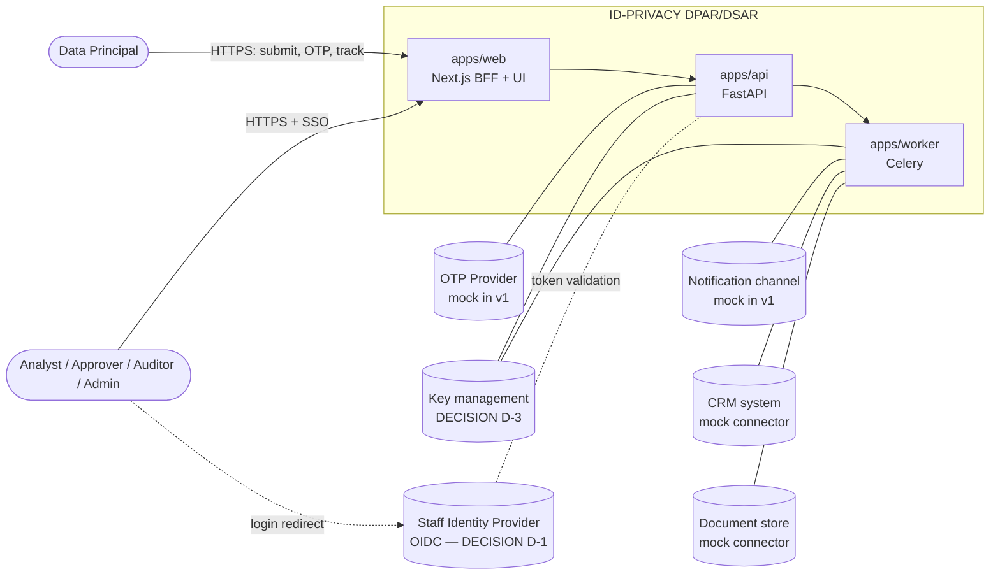
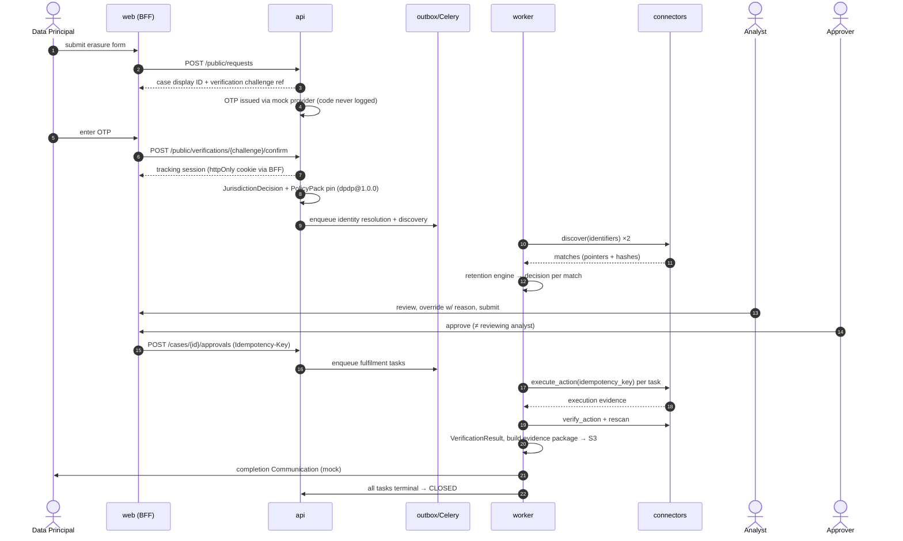

# System Context & Container Architecture

## 1. System context (C4 level 1)



## 2. Containers (C4 level 2) — local development

| Container | Tech | Responsibility | Trust notes |
|---|---|---|---|
| `web` | Next.js (App Router), React, TS | UI plus **BFF**. Holds the staff session (httpOnly cookie) and the DP tracking session. Forwards to the API with a server-side bearer token. Never exposes tokens to browser JS. | Public-facing. CSRF protection for cookie-authenticated mutations. |
| `api` | FastAPI, Pydantic v2, SQLAlchemy 2 (Core/ORM, parameterised) | Synchronous domain operations and authz. Writes state plus an outbox row in one transaction. | Only this container and `worker` hold DB credentials. |
| `worker` | Celery (Redis broker) | Discovery, retention evaluation, fulfilment dispatch, verification, evidence build, communications. | Only component that calls connectors. |
| `postgres` | PostgreSQL 16 | System of record. Append-only `audit_event`. | Separate DB roles: `app_rw`, `audit_writer` (INSERT only), `migrator`. |
| `redis` | Redis 7 | Celery broker/result backend, rate-limit counters. **Not** the system of record. | No PII in task payloads. IDs only. |
| `object-storage` | S3-compatible (SeaweedFS, dev only) | Evidence artifacts. Private bucket, SSE. | Not publicly routable. API streams downloads. |
| `keycloak` | OIDC (dev only) | Stand-in staff IdP for local dev and tests. | **Not** a production choice (D-1). |
| `mock-connectors` | FastAPI | Simulated CRM and document store with seeded data. Honours idempotency keys. | Treated as untrusted external systems. |

## 3. Domain boundaries (modules inside `apps/api` + `apps/worker`)

Each bounded context is a Python package with its own models, service layer and repository. Cross-context calls go through service interfaces, never through another context's tables.

```
domain/
  intake/            request submission, case ID issuance, input validation
  identity/          OTP verification, identity resolution (canonical identifiers)
  policy/            policy-pack loading, versioning, rights catalogue, rule evaluation
  cases/             PrivacyRequest aggregate, state machine, SLA clocks
  discovery/         DiscoveryJob, DataMatch, connector fan-out
  retention/         RetentionDecision engine, LegalHold, exception reasons
  approvals/         maker-checker, approval records
  fulfilment/        FulfilmentTask orchestration, ConnectorExecution, idempotency
  verification/      rescan + reconciliation → VerificationResult
  evidence/          EvidenceArtifact, package builder, manifest hashing
  communications/    DP notifications (mock channel)
  audit/             AuditEvent append, hash chaining, timeline queries
platform/
  auth/              OIDC token validation, DP tracking sessions, RBAC, tenant context
  crypto/            KeyProvider interface, envelope encryption, blind indexes
  storage/           S3 client wrapper
  logging/           structured logging + PII redaction filter
  outbox/            transactional outbox → Celery
packages/
  connector-sdk/     connector interface, idempotency helpers, conformance test kit
  policy-packs/      dpdp/v1/*.yaml (+ JSON Schema)
```

## 4. Erasure slice — sequence



## 5. Case state machine (erasure workflow, DPDP v1)

```
SUBMITTED ─► PENDING_VERIFICATION ─► VERIFIED ─► JURISDICTION_DETERMINED
   │                │ (fail/expire)
   │                └─► VERIFICATION_FAILED (terminal)
   ▼
DISCOVERY_IN_PROGRESS ─► DISCOVERY_COMPLETE ─► RETENTION_EVALUATED
─► UNDER_REVIEW ─► PENDING_APPROVAL ─┬─► APPROVED ─► FULFILMENT_IN_PROGRESS
                                     └─► REJECTED ─► UNDER_REVIEW (rework)
─► VERIFICATION_IN_PROGRESS ─┬─► VERIFIED_COMPLETE ─► EVIDENCE_GENERATED
                             └─► RECONCILIATION_REQUIRED ─► FULFILMENT_IN_PROGRESS
─► RESPONDED ─► CLOSED   (guard: all FulfilmentTasks terminal)

Any non-terminal ─► ON_HOLD (legal hold) / CANCELLED (DP withdraws, with audit)
```

The workflow definition (states, allowed transitions, required roles, guards) is loaded from the policy pack. Handlers call `cases.transition(case, event)` and never set status directly (ADR-0005).

## 6. Production deployment architecture (documentation only — not built in v1)

Target shape, pending decisions D-1 to D-6:

- Stateless `web`, `api` and `worker` containers behind a WAF plus TLS-terminating load balancer. Horizontal scaling. Workers are split by queue (`discovery`, `fulfilment`, `evidence`) so destructive work is isolated.
- Managed PostgreSQL with PITR, encryption at rest, private networking only. Read replica for dashboards.
- Managed Redis (TLS, auth) or a migration to a durable workflow engine (ADR-0005 revisit trigger).
- Object storage with SSE-KMS, versioning, and optionally Object Lock/WORM for evidence (D-4).
- KMS/HSM-backed key hierarchy: a per-tenant KEK wraps DEKs (D-3).
- Connectors that reach customer systems run in an egress-controlled network segment. On-prem systems may need a customer-hosted connector agent (D-11).
- Centralised log pipeline that receives already-redacted logs. SIEM gets audit events via a one-way export.
- Region pinning per tenant for data residency (D-6).
